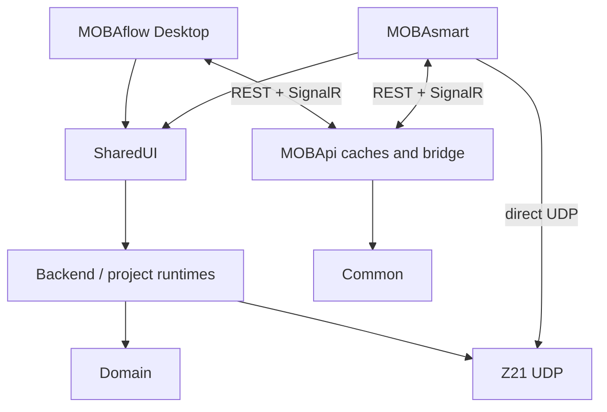
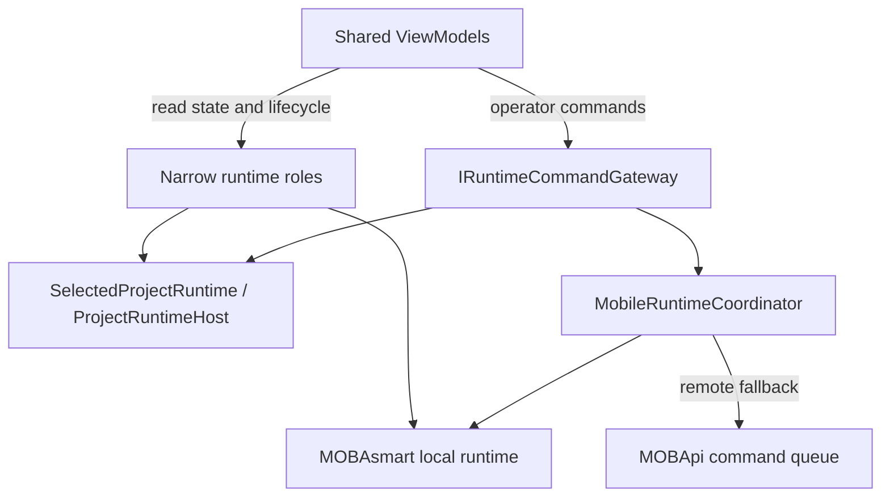
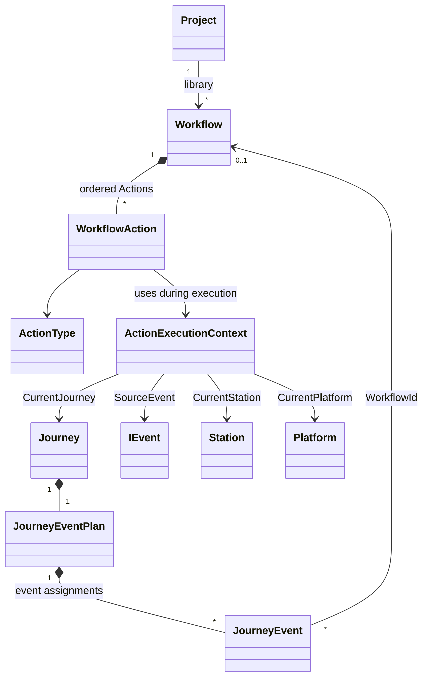
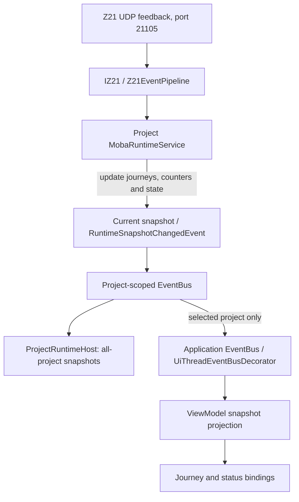
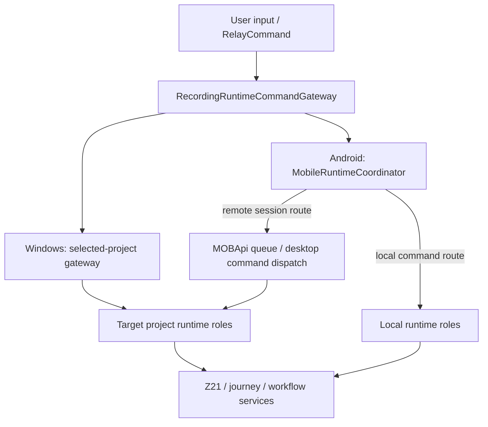

# MOBAflow Architecture

## 📐 System Overview

For the current repository-wide implementation reference, including pages,
models, workflow action support, display rendering, ESP32-S3 transport,
configuration files, build/deploy commands, and documentation findings, see
[`PROJECT-REFERENCE.md`](PROJECT-REFERENCE.md).

MOBAflow is built on **Clean Architecture** principles with a clear
separation of concerns:



MOBApi is deliberately a thin standalone host that references `Common`, not
`SharedUI` or `Backend`. MOBAflow publishes the current solution and runtime
snapshots to it and consumes remote commands from it.

## 🏗️ Architecture Layers

### Project dependency rules

Dependencies point from the hosts towards `Domain`. Each project lists its
direct project references; a project may also reference any project it already
reaches through these edges, never one above it. The architecture test reads
this table, so it is the single source of these rules.

| Project | Root namespace | References |
| --- | --- | --- |
| `Domain` | `Moba.Domain` | none |
| `TrackLibrary.Base` | `Moba.TrackLibrary.Base` | none |
| `Common` | `Moba.Common` | `Domain` |
| `Sound` | `Moba.Sound` | `Common` |
| `Speech.Base` | `Moba.Speech.Base` | `Common` |
| `Speech.Piper` | `Moba.Speech.Piper` | `Speech.Base` |
| `Speech.SystemSpeech` | `Moba.Speech.SystemSpeech` | `Speech.Base` |
| `Backend` | `Moba.Backend` | `Common`, `Domain`, `Sound`, `Speech.Base` |
| `TrackPlan.Renderer` | `Moba.TrackPlan.Renderer` | `TrackLibrary.Base` |
| `TrackLibrary.PikoA` | `Moba.TrackLibrary.PikoA` | `TrackLibrary.Base`, `Domain`, `TrackPlan.Renderer` |
| `MOBAdisplay` | `Moba.Display` | `Domain` |
| `MOBApi` | `Moba.MOBApi` | `Common` |
| `SharedUI` | `Moba.SharedUI` | `Backend`, `Common`, `MOBAdisplay`, `TrackPlan.Renderer`, `TrackLibrary.PikoA` |
| `MOBAflow` (WinUI host) | `Moba.WinUI` | `Backend`, `Common`, `MOBApi`, `SharedUI`, `TrackLibrary.Base`, `TrackPlan.Renderer`, `TrackLibrary.PikoA`, `MOBAdisplay`, `Speech.Piper`, `Speech.SystemSpeech` |
| `MOBAsmart` (MAUI host) | `Moba.MAUI` | `SharedUI`, `Common`, `Sound`, `Speech.Base` |

Further rules:

- Only `MOBAflow` uses WinUI and only `MOBAsmart` uses MAUI. Every other
  project stays free of UI framework types. `Speech.Piper` and `Speech.SystemSpeech` target Windows
  for synthesis; `Speech.Base` remains platform-neutral and is the only speech project referenced by MOBAsmart.
- Project references point to projects in `Moba.slnx`. The rules also apply
  to `Directory.Build.props`, `Directory.Build.targets` and imported build files.
- Every namespace declared in a project starts with the root namespace in the
  table.
- A new project needs a row in this table.

`Test/Architecture/SolutionArchitectureTests.cs` enforces these rules from this
table, the project and build files, and the C# syntax of the sources; a failure
message names the broken rule.

### Speech dependency rule

`Speech.Base` owns the provider contracts, structured results and shared output. `AnnouncementService`,
workflow execution contexts and the Settings test command all use `ISpeechOutput`. It captures the current
provider ID and shared request options on each call. Local providers synthesize WAV data without opening
an audio device; MOBAflow's cancellable WAV player owns audible playback. `Sound` keeps sound effects and
no longer references `System.Speech`. Android registers `NullSpeechOutput` and includes no Windows provider.

### Track-plan dependency rule

Track-plan code follows an explicit inward dependency direction:

`TrackLibrary.Base contracts → TrackPlan.Renderer → platform adapters`

`TrackLibrary.PikoA` implements catalogue-specific geometry and may depend on
`TrackLibrary.Base`; the neutral renderer must never reference Piko A. Win2D
conversion stays in the Windows host. Runtime projection of EventBus feedback,
timers and railroad state belongs to `Backend/Service/TrackPlan`, not `SharedUI`.
`Test/TrackPlanRenderer/TrackLayoutArchitectureTests.cs` protects these rules.

### 1. **Domain Layer** (`Domain/`)

**Purpose:** Pure business logic, independent from UI or infrastructure.

**Content:**

- POCO Models (Solution, Journey, Workflow, FeedbackPoint, etc.)
- Domain Events & Aggregates
- Business Rules & Validation Logic

**Key Classes:**

The persisted domain uses mutable POCO classes such as `Solution`, `Project`,
`Journey`, `Station`, `Workflow`, and `WorkflowAction`. A workflow stores a
reusable ordered list of typed actions. Events reference its stable ID and supply
the context of each execution. Runtime snapshots
are the immutable boundary exposed to UI consumers.

**Characteristics:**

- ✅ **Framework-agnostic** - No dependencies on UI frameworks
- ✅ **Testable** - Unit tests without mocking UI
- ✅ **Reusable** - Shared across all platforms (MOBAflow, MOBAsmart)
- ✅ **Serializable** - JSON for configuration files

---

### 2. **Backend/Service Layer** (`Backend/`, `Common/`)

**Purpose:** Application services, coordination, external integrations.

**Content:**

- IZ21 (Z21 Control Station Communication)
- IMobaRuntime / MobaRuntimeService (authoritative runtime owner)
- `WorkflowService` (validated ordered action execution and dry-run planning)
- `WorkflowValidator` and `WorkflowEffectPlanner`
- `WorkflowExecutionCoordinator` (FIFO execution per journey)
- `WorkflowTraceStore` (bounded in-memory lifecycle projection)
- `ActionExecutor` and typed action handlers (live effects only)
- `MasterDataStore` (shared cities/locomotives/multiplex master JSON, e.g. `data.json`)
- `ActiveProjectContext` (runtime project activation inside `MobaRuntimeService`)
- Runtime Snapshots (MobaRuntimeSnapshot, JourneyRuntimeSnapshot)
- Configuration & Settings Management
- Logging Infrastructure (Serilog)

**Key Interfaces:**

```csharp
public interface IZ21 : IZ21Connection, ILocoControl, IAccessoryControl, IZ21Diagnostics
{
}

public interface IMobaRuntime
{
    MobaRuntimeSnapshot Current { get; }
    Task ActivateProjectAsync(Project editableProject, CancellationToken cancellationToken = default);
    Task ConnectAsync(CancellationToken cancellationToken = default);
    Task SetTrackPowerAsync(bool isOn, CancellationToken cancellationToken = default);
}

public interface IActionExecutor
{
    Task ExecuteAsync(
        WorkflowAction action,
        ActionExecutionContext context,
        CancellationToken cancellationToken = default);
}

public interface IWorkflowService
{
    Task<WorkflowExecutionResult> ExecuteAsync(
        WorkflowExecutionRequest request,
        CancellationToken cancellationToken = default);
}
```

**Characteristics:**

- ✅ **UDP Communication** - Direct Z21 protocol (no HTTP/REST dependencies)
- ✅ **Async-First** - All I/O operations use async/await
- ✅ **DI-Friendly** - Registered in ServiceCollection
- ✅ **Logging** - Structured logging with Serilog

---

### 3. **Presentation Layer** (`SharedUI/`)

**Purpose:** Shared ViewModels, MVVM infrastructure, cross-platform utilities.

**Content:**

- `SolutionSession` (solution ownership, selection, dirty state and auto-save)
- MainWindowViewModel (navigation and shell state, with page extraction reserved for RF-24)
- Page-specific ViewModels (JourneyViewModel, WorkflowViewModel, etc.)
- ViewModels read runtime state through narrow runtime roles and send commands through
  `IRuntimeCommandGateway` (see [Runtime command path](#runtime-command-path))
- MVVM Commands & Converters
- Observable Property Definitions

**Runtime access pattern:**

| ViewModel responsibility | Required dependency |
| --- | --- |
| Read current operating state | `IRuntimeSnapshotProvider` |
| Start, activate a project, connect or disconnect | `IConnectionRuntime` |
| Inspect traffic | `ITrafficMonitor` |
| Send an operator command | `IRuntimeCommandGateway` |

See the actual [runtime roles](../Backend/Interface/IMobaRuntime.cs),
[command gateway](../SharedUI/Interface/IRuntimeCommandGateway.cs), and
[MainWindowViewModel constructor](../SharedUI/ViewModel/MainWindowViewModel.cs).
ViewModels do not receive the complete `IMobaRuntime` or create their own gateway.

**Characteristics:**

- ✅ **Platform-Agnostic** - Used by MOBAflow and MOBAsmart (MOBApi is a thin REST host with only `Common`)
- ✅ **MVVM Toolkit** - CommunityToolkit.Mvvm for source generators
- ✅ **Observable Properties** - Reactive UI updates
- ✅ **Commands** - RelayCommand for user interactions

---

### Runtime Boundary (Current Refactoring State)

The runtime split now covers the shared shell and the remaining
Z21-driven shared ViewModels:



On Windows, `ProjectRuntimeHost` owns the per-project runtimes and
`SelectedProjectRuntime` exposes the selected one. On Android, the read roles
resolve to the local runtime; the command coordinator chooses local or remote
execution. The full `IMobaRuntime` contract is reserved for hosts, gateways and
runtime services.

**Responsibilities of `IMobaRuntime` / `MobaRuntimeService`:**

- Owns Z21 connection state, auto-connect, disconnect and track power
- Owns active project execution via `ActiveProjectContext` and constructs
  `JourneyManager` when a project is activated
- Surfaces traffic monitor access, locomotive commands, multiplex signals,
  journey reset, and fail-safe / operator-ack state
- Publishes runtime projections via `MobaRuntimeSnapshot`
  (system, journeys, counters, locomotives and signal-box state)
- Implementation is split into partial files under `Backend/Service/`
  (`RuntimeApi`, `Z21Handlers`, `AutoConnect`, and the core snapshot/constructor file)

**ViewModel wiring:**

- `MainWindowViewModel`, `TrainControlViewModel`, and `MauiViewModel` take the
  runtime roles they read (`IRuntimeSnapshotProvider`, `IConnectionRuntime`,
  `ITrafficMonitor`) and a required `IRuntimeCommandGateway` from DI. MOBAsmart
  registers one `MobaRuntimeService` behind every role; MOBAflow registers the
  selected project's runtime (see below)
- Journey-related UI still receives state from snapshots rather than owning
  `JourneyManager` directly

**Solution ownership and the RF-24 boundary:**

- `SolutionSession` is the single owner of the loaded solution, selected project
  and journey, dirty state and auto-save. Hosts register the same instance as
  `ISolutionSession`, `IProjectContext` and `IJourneySelectionContext`.
- Shared ViewModels and host services reach solution ownership through those
  contracts. The existing shell/composition, WinUI page bindings, column-width
  behavior, MonitorPageViewModel, EventManagerViewModel and Android shutdown
  lookup remain explicitly named in
  [SolutionSessionArchitectureTests](../Test/Architecture/SolutionSessionArchitectureTests.cs).
  RF-24 removes the page, layout and shell-state dependencies; RF-23 adds no new
  exception and does not claim that decomposition is already complete.
- The [RF-23 acceptance record](../specs/008-project-runtimes/acceptance.md)
  maps the feature criteria to tests and distinguishes automated evidence from
  app/device and live-hardware checks.

**Locomotive presentation (RF-24 slice 2a):**

- The host owns one `LocomotivesPageViewModel`, shared by LocomotivesPage and the locomotive
  library in TrainsPage. It depends on ISolutionSession, existing I/O/settings services,
  LayoutColumnWidthsViewModel and the existing LocomotiveManagementViewModel; it has no shell dependency.
- Selection, search/filter identity, inventory CRUD, photo commands and panel expansion belong
  to the focused editor. The session keeps canonical project selection and auto-save ownership.
  Decoder/CV/passport presentation continues to use the same management instance.
- Uploaded-photo navigation stays in the shell and forwards locomotive assignments to the editor.
  The host supplies the Windows Explorer action; shared presentation contains no Explorer launch.
  Photo copying retains the initiating entity/solution checks and ignores results after disposal.
- The page coordinates visual column widths and matching load/unload subscriptions. Editor disposal
  releases session, collection and model handlers without changing bound state during shutdown.
  The architecture guard rejects shell dependencies in LocomotivesPage. Train-composition
  and central layout-persistence extraction remain later RF-24 slices.

**Wagon presentation (RF-24 slice 2b):**

- The host owns one WagonsPageViewModel, shared by PassengerWagonPage, GoodsWagonPage and both
  wagon libraries in TrainsPage. It reads ISolutionSession directly and reuses the existing
  I/O/settings services and LayoutColumnWidthsViewModel without depending on the shell.
- Passenger/goods selection, search, stable filter identity, inventory CRUD, photos and persisted
  expansion state belong to this editor. The session owns project selection and auto-save;
  the inventory pages retain their visual column-width handling and load/unload subscriptions.
- The shell's small photo-assignment partial forwards uploaded photos to the active editor.
  The host adapts Windows Explorer launching. Asynchronous copies retain the initiating
  entity/solution checks, refresh image bindings for repeated paths and ignore results after disposal.
- The editor detaches session, project-collection and selected-model subscriptions at shutdown.
  The architecture guard rejects shell dependencies in both wagon inventory pages.
  Train composition and central layout persistence remain later slices.

**Settings presentation (RF-24 slice 1):**

- The host owns one `SettingsPageViewModel`, shared by SettingsPage and the shell's theme and
  speech selectors. Its required dependencies are AppSettings, ISettingsService, the UI dispatcher
  and logging; speech testing uses the existing host action. It never depends on MainWindowViewModel.
- The ViewModel owns settings persistence, feature items, Piper choices, reset commands and section
  state. SettingsPage keeps file pickers and visual ordering/reset feedback.
- The shell retains counter/status projections until later slices. It reacts only to actual valid
  feedback-count changes and speech selection, and detaches subscriptions at shutdown. The
  architecture guard rejects shell dependencies in the extracted SettingsPage.

**One runtime per project (MOBAflow):**

- `ProjectRuntimeHost` (`Backend/Service/ProjectRuntimes/`) holds one runtime per
  project of the loaded solution; all run at the same time. `ProjectRuntimeFactory`
  builds each runtime graph (runtime service, journey and workflow execution,
  feedback counters with a per-project file, interlocking, whistle automation) on
  the connection of the project's Z21. Stateless workflow handlers, stores and
  audio are shared.
- `Z21ConnectionRegistry` owns one connection per Z21 address for the app lifetime.
  A runtime created again for the same Z21 (reloading the solution) takes over the
  open connection. When two projects use the same Z21, the earlier project in the
  solution connects; the later runtime gets a detached connection, reports the
  conflict and never connects (`Z21AssignmentDiagnostics` shows it in the project
  diagnostics). MOBAflow never searches the network for a Z21 on its own
  (`ProjectZ21EndpointSource`). MOBAsmart uses the same endpoint source with the
  project selected on the phone; switching projects changes its local Z21 connection.
- Each connection has its own `ForwardingEventBus`. Runtime handlers run on the
  publishing thread without waiting for the UI dispatcher. Only application
  delivery is dispatched to the UI thread and checks the current selection there;
  only the selected project's bus publishes to the application bus,
  so UI subscribers keep their contract and show the selected project.
  `SelectedProjectRuntime` and `SelectedProjectInterlocking` give pages and host
  services the selected project's runtime and interlocking; project updates are
  routed by project id.
- `SolutionSession` creates and discards the runtimes through `IProjectRuntimeHost`
  on solution load and new, project add and remove, and recreates a runtime when
  its project's Z21 changes. Selecting a project only selects its runtime; it never
  activates or restarts one.
- Safe switch: before the host discards a connected runtime (solution switch, project
  removal, a changed Z21 assignment, app close), the runtime sets every known
  locomotive (commanded, seen on its Z21 or listed in its project) to speed 0. The
  shell asks first ("Stop all trains?") before a new or opened solution, a project
  deletion or closing MOBAflow when an affected runtime is connected; cancelling keeps
  everything running.
- Manual disconnect also stops known locomotives before logging off. Stop commands use
  DCC addresses 1–9999 and continue after individual send failures. Failed manual stops
  keep the connection available for retry; host shutdown passes its cancellation token
  through the stop loop and disposes a runtime when its stop is cancelled.
- Remote control per project: every runtime snapshot names its project
  (`MobaRuntimeSnapshot.ProjectId`). MOBAflow pushes the snapshots of all project
  runtimes; MOBApi caches one snapshot per project. A MOBAsmart remote registers for
  one project and receives only that project's snapshots, and every remote command
  names its project. MOBApi rejects commands for a project the synchronized solution
  does not contain; MOBAflow's `ProjectRuntimeCommandRouter` runs a command in that
  project's runtime only.
- Covered by `Test/Backend/ProjectRuntimeHostTests.cs`,
  `Test/SharedUI/MainWindowViewModelShutdownTests.cs` and the project routing tests in
  `Test/MOBApi/` and `Test/MOBAflow/ProjectRuntimeCommandRouterTests.cs`.

**Editor vs runtime state (done):**

- The runtime reads master data from a **snapshot** of the editor `Project`
  (`CloneForRuntime`, JSON round-trip via `JsonOptions.Compact`), because it reads
  journeys, stations and workflows on background threads while the editor changes
  them on the UI thread. Runtime mutations never touch the editor model.
- The solution session refreshes the snapshot after every saved change through
  `IConnectionRuntime.UpdateProjectAsync`, without re-activation: journey progress
  (`JourneySessionState`, kept by stop id), running workflows and signal aspects are
  kept; a running workflow finishes with the snapshot it started with. Adding or
  removing journeys, stations or trains no longer restarts the project; only
  creating the project's runtime activates it. The interlocking definition still
  changes only on activation.
- Entity Ids are preserved by the round-trip, so snapshots and journey reset keep
  resolving against the Ids the editor exposes.
- Covered by `Test/Backend/MobaRuntimeServiceProjectIsolationTests.cs` and
  `Test/Backend/MobaRuntimeEventPlanTests.cs`.

### Workflow execution boundary

A workflow is a reusable ordered list of actions. An event triggers it and supplies its execution context:



`Workflow`, `WorkflowAction`, `JourneyEventPlan`, `JourneyEvent`, `Journey`, `Station` and `Platform`
are persisted Domain classes. `ActionExecutionContext` is an existing Backend runtime
class; `IEvent` belongs to Common. Event assignments own the workflow reference;
a workflow does not own its triggers and can be reused by multiple assignments.

- JourneyManager captures the event, correlation and journey; it resolves the current
  stop when the queued execution starts, after the previous execution finishes.
  `WorkflowExecutionCoordinator` preserves FIFO execution per journey.
- `WorkflowValidator` checks identifiers, a nonempty action list, typed payloads
  and nonnegative delays. Invalid drafts elsewhere in the library do not block a valid run.
- `WorkflowService` awaits each action in list order and its optional `DelayAfterMs`.
  The first failure or cancellation stops the sequence. Number is a display ordinal.
- Each invocation gets its own `ActionExecutionContext` container. Service dependencies
  and the active journey session remain shared intentionally. A stop change updates
  the invocation context so subsequent actions see the new stop.
- `SourceEvent` accepts any `IEvent`; current Event Manager assignments are feedback
  occurrences. This change does not introduce a catalogue or subscription UI for other events.
- Dry run plans effects in the same order without calling live handlers or waiting.
- Lifecycle/trace contracts remain compatible: `StepId` now identifies an action.
  The trace store retains at most 100 executions and 10,000 entries by default.
- WorkflowsPage edits the reusable action library; EventManagerPage assigns workflows.
  Both share `WorkflowLibraryViewModel` and authoritative project wrappers.
- Graph conditions, parallel/nested steps, retries and explicit termination are removed.
  Earlier graph definitions retain metadata but load with no actions; validation prevents
  execution until the operator recreates them. No automatic graph flattening is performed.

See [issue #132](https://github.com/ahuelsmann/MOBAflow/issues/132) and the
[specification](../specs/002-workflow-action-sequences/spec.md).

**Planned refactoring (`MainWindowViewModel` decomposition):**

- `MainWindowViewModel` is still a large aggregate (~18 partial files, ~17 ctor
  dependencies). The next maintainability step is extracting cohesive child
  ViewModels (e.g. a `SystemStatusViewModel` for speech-health / REST-API /
  post-startup status).
- This requires updating compile-time `x:Bind` bindings in WinUI and MAUI XAML, so
  it must be done and verified with the platform UI build (not part of the
  cross-platform subset).

---

#### Threading and the UI-thread boundary

Z21, file I/O, timers and post-startup work can run on background threads.
The undecorated EventBus invokes subscribers synchronously on the publishing
thread. Updating WinUI-bound state from that thread can cause UI-thread violations.

Both UI hosts register `AddEventBusWithUiDispatch()`. Its
[UiThreadEventBusDecorator](../SharedUI/Service/UiThreadEventBusDecorator.cs)
forwards publication through `IUiDispatcher.InvokeOnUiLowPriority`: publication
on the UI thread invokes handlers immediately; background publication queues
them and returns. Handlers using this decorated bus update UI state directly
and must not dispatch again.

Callbacks outside the decorated bus are separate threading boundaries. Inspect
their actual execution context before changing UI-bound state; use the existing
dispatcher adapter or platform bridge where needed. Examples include raw Z21
callbacks, timers, file-load completions and health-status callbacks from
`MOBAflow/View/MainWindow.xaml.cs`. Do not assume every asynchronous continuation
is a background callback, or introduce platform UI types into shared logic.

---

### 4. **Platform-Specific Layers** (`MOBAflow/`, `MOBAsmart/`, `MOBApi/`)

**Purpose:** UI rendering, platform-specific features, page and API definitions.

**MOBAflow (Windows Desktop, WinUI 3):**

```text
MOBAflow/
├── View/               # XAML Pages (MainWindow, JourneyPage, etc.)
├── ViewModel/          # WinUI-specific ViewModels
├── Service/            # WinUI Services (NavigationService, etc.)
├── Converter/          # XAML Value Converters
└── Resources/          # Styles, Brushes, Templates
```

**MOBAsmart (Android, .NET MAUI):**

```text
MOBAsmart/
├── View/               # XAML Pages (MainPage, etc.)
├── Resources/          # Styles, Colors, Fonts
├── Platforms/          # Platform-specific code (Permissions, etc.)
└── Service/            # MAUI Services
```

**MOBApi (REST API, ASP.NET Core):**

```text
MOBApi/
├── Controllers/        # REST API Controllers
├── Hubs/               # SignalR Hubs
└── Service/            # API Services
```

---

## 🔄 Data Flow

### Z21 Feedback Flow



`MobaRuntimeService` updates `IRuntimeSnapshotProvider.Current` and publishes
`RuntimeSnapshotChangedEvent`; `IMobaRuntime` has no `SnapshotChanged` event.
[`ProjectRuntimeHost`](../Backend/Service/ProjectRuntimes/ProjectRuntimeHost.cs)
subscribes to every project's bus and exposes all-project snapshot updates through
`IProjectRuntimeSnapshots`. Only the selected project's bus forwards feedback to
the application bus. Selecting another project publishes its current snapshot
through `SelectedProjectRuntime`. The UI decorator dispatches EventBus subscribers
to the UI thread; ViewModels apply snapshots without a second dispatch.
MOBAsmart instead reads its local runtime and combines local, remote and cached
state through the mobile components below.

### Command Execution Flow



Every operator command enters through `IRuntimeCommandGateway`. The host owns
recording and routing; ViewModels do not call `IMobaRuntime` directly. Hardware
commands use the target runtime's Z21 connection. On Android, locomotive commands
prefer the connected local Z21 and fall back to an active remote session; signal
aspects prefer the active remote session. Track power, counters and raw turnout
commands stay local. Workflow execution separately
passes the mandatory `WorkflowValidator` gate before effect planning (dry run) or
live action execution; ordinary connection and locomotive commands do not pass
through that workflow pipeline. Resulting runtime snapshots refresh the UI.

### MOBAsmart session and projection

These platform-neutral components live in [`SharedUI/Mobile`](../SharedUI/Mobile)
and are registered as singletons by
[`MobaMauiServiceCollectionExtensions`](../MOBAsmart/Extensions/MobaMauiServiceCollectionExtensions.cs):

| Component | Responsibility and owned state |
| --- | --- |
| [`MobaflowHubSession`](../SharedUI/Mobile/MobaflowHubSession.cs) | REST health checks, client registration cadence and SignalR connect retries/forced reconnect. Returns connection outcomes; the caller applies UI state. A failed REST check alone does not close an already connected hub. |
| [`MobileRuntimeProjection`](../SharedUI/Mobile/MobileRuntimeProjection.cs) | Holds the latest remote fleet and signal-box snapshots, including restored cache data. Filters to the selected project and chooses/merges live remote, synchronized project, cached and local runtime data. Persists remote snapshots through `IMobileSolutionStore`; restored fleet data starts as stale. |
| [`MobileSolutionSynchronizer`](../SharedUI/Mobile/MobileSolutionSynchronizer.cs) | Serializes initial catalog imports, tracks whether the current session's catalog was applied, and delegates push, periodic and on-demand solution refresh to `ISolutionRemoteLoader`. On-demand refresh can load the phone's cache first. |
| `MauiViewModel` | Coordinates these services, owns EventBus/hub subscriptions, health-check loop and lifetime cancellation, and applies results to tabs and bound state on the UI thread. |

`MobileSolutionStore` owns disk persistence; `SolutionSession` owns the loaded
solution and selection. Projection data does not become a second editable
solution or runtime. After the initial catalog is shown, periodic refresh takes
over; session loss or a connection-toggle change resets the import flag. App
shutdown cancels ongoing work and releases the ViewModel's subscriptions;
`RuntimeHubRemoteClient` owns the underlying SignalR transport lifecycle.

---

## 📦 Dependency Injection Container

The DI container (`Microsoft.Extensions.DependencyInjection`) is the
heart of the architecture:

### Registration Structure

Selected registrations from
[MobaWinUiServiceCollectionExtensions](../MOBAflow/Extensions/MobaWinUiServiceCollectionExtensions.cs);
its host composition also supplies the required factories and platform services:

```csharp
// Per-project runtime ownership and selected-project adapters
services.AddSingleton<IProjectRuntimeHost>(sp => sp.GetRequiredService<ProjectRuntimeHost>());
services.AddSingleton<IProjectRuntimeSnapshots>(sp => sp.GetRequiredService<ProjectRuntimeHost>());
services.AddSingleton<IMobaRuntime, SelectedProjectRuntime>();
services.AddSingleton<IInterlockingRuntime, SelectedProjectInterlocking>();

// One solution session shared by all presentation contracts
services.AddSingleton<ISolutionSession>(sp => sp.GetRequiredService<SolutionSession>());
services.AddSingleton<IProjectContext>(sp => sp.GetRequiredService<SolutionSession>());
services.AddSingleton<IJourneySelectionContext>(sp => sp.GetRequiredService<SolutionSession>());

// Operator commands use the host-owned recording gateway
services.AddSingleton<IRuntimeCommandGateway>(sp =>
    sp.GetRequiredService<RecordingRuntimeCommandGateway>());
```

Desktop pages are registered in
[`NavigationRegistration`](../MOBAflow/Service/NavigationRegistration.cs).
External DLL discovery and plugin loading are not implemented.
`PostStartupInitializationService.InitializePluginsAsync` currently publishes
status messages only; it does not load or initialize external plugins.

### Resolution Example

The [MainWindowViewModel constructor](../SharedUI/ViewModel/MainWindowViewModel.cs)
receives `SettingsPageViewModel`, `LocomotivesPageViewModel`, `WagonsPageViewModel`, `ISolutionSession`, `IRuntimeSnapshotProvider`, `IConnectionRuntime`,
`ITrafficMonitor` and `IRuntimeCommandGateway`, together with its other shell and
platform services. It does not receive the mutable `Solution` or a complete
`IMobaRuntime`. The runtime roles resolve to selected-project adapters on Windows;
MOBAsmart composes one local runtime and its local/remote command coordinator.

---

## 🛡️ Error Handling & Robustness

### Event bus (`IEventBus`)

- Handlers run sequentially per publish; one failing handler does **not** cancel
  the others.
- Failures are logged at **error** level; when a debugger is attached, an extra
  `Debug.WriteLine` aids local diagnosis (see `Common/Events/IEventBus.cs`).

### Recorder isolation boundary

- Live capture occurs in `RecordingEventBusDecorator` before UI dispatch and persists only explicitly mapped payloads.
- Explicit WinUI, MOBAsmart, RuntimeHub, and REST-fallback commands pass through `IRuntimeCommandGateway`; `RecordingRuntimeCommandGateway` records sanitized correlated request/outcome entries around the concrete local or mobile gateway.
- Command failures retain only the bounded outcome `failed` or `cancelled`; exception messages, stack traces, paths, endpoints, credentials, and raw payloads never cross the recording boundary.
- Locomotive information queries record display-only requests and outcomes. All-functions-off records one operator request even when the mobile coordinator sends 32 individual function commands.
- Replay never publishes recorded events to the root EventBus and never calls `IMobaRuntime` or `IZ21`.
- `RecordingReplayService` schedules journal entries against a freshly constructed, in-memory `IsolatedReplayRuntime`.
- The isolated runtime factory does not receive the production service provider or any external-effect adapter.
- A separate read-only safety gate blocks play, step, and seek while the production runtime reports an active Z21 connection and rechecks before each application.
- Pause cancels the current scheduled wait; seek and reset rebuild isolated state from position zero without changing production state.

### Graceful Degradation

```text
If Z21 Connection Fails:
  • App still starts
  • UI shows "Disconnected" status
  • Commands are disabled
  • No actions can execute
```

### Logging Strategy

```text
Critical: App won't start
  └─ DI setup failure
  └─ Configuration corruption

Error: Feature won't work
  └─ Z21 connection lost

Warning: Unexpected but recoverable
  └─ Missing configuration value

Info: Normal operations
  └─ Z21 connected
  └─ Command executed

Debug: Diagnostic info
  └─ Property changed
  └─ Event fired
  └─ Service method called
```

---

## 🔗 Layer Communication

### How Layers Interact

```text
User Input (UI Layer)
  ↓
ViewModel Command (Presentation Layer)
  ↓
Service Method (Backend Layer)
  ↓
Domain Model Logic (Domain Layer)
  ↓
External Integration (Z21 UDP)
  ↓
Result back up the stack
  ↓
Observable Property Update
  ↓
UI Re-renders
```

### Runtime command path

Every operator command from a ViewModel (track power, fail-safe acknowledgement,
locomotive drive and functions, signals, turnouts, counters, journey reset) goes
through one port, `IRuntimeCommandGateway`:

```text
ViewModel ──► IRuntimeCommandGateway
                 MOBAflow:  RecordingRuntimeCommandGateway ─► LocalRuntimeCommandGateway ─► runtime
                 MOBAsmart: RecordingRuntimeCommandGateway ─► MobileRuntimeCoordinator ─► local Z21 or MOBAflow
```

- The hosts create and register the gateway; ViewModels receive it in their
  constructor and never create one.
- ViewModels read state through `IRuntimeSnapshotProvider`, run lifecycle and
  connection steps (start, activate project, connect, disconnect) through
  `IConnectionRuntime`, and use `ITrafficMonitor` for diagnostics. The command
  roles `ILocomotiveRuntime` and `ILayoutControlRuntime` and the complete
  `IMobaRuntime` are reserved for hosts, gateways and runtime services.
- The signal-box editor sends signal id and aspect. Because the runtime
  executes a copy of the project, a persisted signal-box change first refreshes
  the runtime's project snapshot (`IConnectionRuntime.UpdateProjectAsync`);
  journeys and workflows keep running. Editor changes run in call order, so an
  aspect never overtakes a configuration update.
- `Test/Architecture/RuntimeCommandPathArchitectureTests.cs` fails when a
  ViewModel uses a command role or creates a gateway.
- Fail-safe acknowledgement and all functions off record requests that can be
  applied to isolated replay state, plus display-only outcomes. Locomotive info
  requests and outcomes are display-only. MOBAsmart injects the recording gateway
  for throttle and signal commands; the coordinator selects their local or remote route.

### Notification mechanisms

Each kind of change has one owner mechanism:

| Change | Mechanism | Example |
| --- | --- | --- |
| Runtime events (something happened: feedback, connection, track power) | `IEventBus` events in `Common/Events` and `Backend/Events` | `FeedbackReceivedEvent` |
| Runtime state (what is true now) | Immutable snapshots read from `IRuntimeSnapshotProvider.Current`; changes are announced on the EventBus | `MobaRuntimeSnapshot`, `RuntimeSnapshotChangedEvent` |
| Component events (inside one service or control and its direct owner) | Plain C# `event` | `InPortCounterService.SnapshotChanged` |
| UI binding | `INotifyPropertyChanged` through CommunityToolkit observable properties | ViewModel properties |

New code uses the mechanism of the row its change belongs to. A C# event stays
between a component and its direct owner, for example `InPortCounterService`
and `MobaRuntimeService`.

---

## 📊 Technology Decisions

- **UI:** WinUI 3 (MOBAflow), .NET MAUI (MOBAsmart)
  - **Why:** Native look & feel, platform-specific features
- **API:** ASP.NET Core REST + SignalR (MOBApi)
  - **Why:** Lightweight REST + real-time hub
- **MVVM:** CommunityToolkit.Mvvm
  - **Why:** Source generators, zero-reflection overhead
- **DI:** Microsoft.Extensions.DependencyInjection
  - **Why:** Standard .NET DI, no external dependencies
- **Logging:** Serilog
  - **Why:** Structured, extensible, file + in-memory sinks
- **Z21 Protocol:** UDP (direct)
  - **Why:** Low latency, no external dependencies
- **Testing:** NUnit
  - **Why:** Simple, focused unit tests

---

## MOBAsmart / MOBAflow runtime sync

MOBAsmart and MOBAflow coordinate through MOBApi (solution catalog, RuntimeHub snapshots,
remote commands). Z21 LAN broadcasts do not replace this layer because they carry DCC-level
state only. See [Z21-MOBAFLOW-SYNC.md](Z21-MOBAFLOW-SYNC.md) for the full decision record,
slim snapshot profile, and observability endpoints.

---

## 🚀 Future Extensibility

The architecture supports:

- ✅ **New UI Platforms** - Just implement UI layer above SharedUI
- ✅ **New Services** - Add to Backend, register in DI
- ✅ **Protocol Upgrades** - Encapsulated in IZ21
- ✅ **Configuration Expansion** - AppSettings extensible
- ✅ **Domain Evolution** - Models can change independently

---

**Last Updated:** 2026-10-13 (runtime flows and mobile responsibilities checked against current source)
