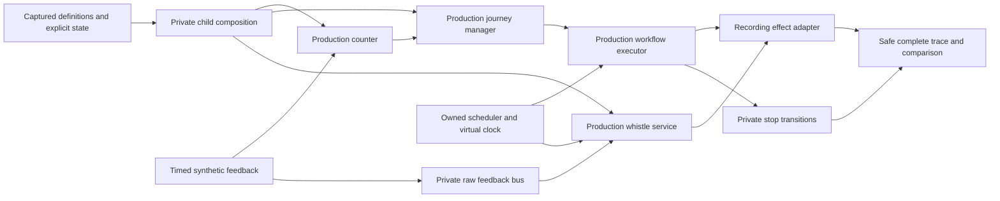

# Implementation Plan: Isolated Automation Testbench

**Branch**: `codex/issue-35-technical-plan` | **Date**: 2026-10-11 | **Spec**: [spec.md](spec.md)

**GitHub Issue**: #35

**Spec Kit**: Required

**Status**: Design #241 and backlog/consistency analysis #245 are integrated. Foundation implementation has started.

Implementation revalidation on 2026-10-14: GitHub main and this dedicated worktree start at
`7c1d92422c0cbf675fddc03a8979990957733d15`, branch `codex/issue-35-automation-testbench`.
GitHub confirms #241 merged as `4fa6402cfd0a2011a1d519eed6526a62142ff006` and #245 as
`7013de9a3b8143cffb082904fcfa7da540ff9948`; the accepted backlog PR contains the 26/26 consistency mapping.
The 16-item requirements checklist is complete. No extension hooks are configured.
Current factory still acquires a live connection lease; sequence execution still uses ordered actions and TimeProvider delays.
Handlers still own environment probes. The first reviewable slice extracts their shared effect boundary (T009-T010),
before scheduler/private graph/UI work. Definition tasks T005-T008 remain a separate foundation slice.
RF-24/#219 and #141 do not block this work. No real/shipped/example solution, app launch or hardware work is authorized.
The Constitution Check below was revalidated against current AGENTS.md: no exception is introduced by this slice.

**Input**: Feature specification from `specs/010-automation-testbench/spec.md`.

## Summary

Build a Windows editor for reusable project-owned scenarios and a platform-neutral runner that exercises the production
counter, journey, ordered-action and whistle services. Each run owns a captured project, private event bus, state stores,
virtual clock and recording effects. It never constructs a live connection or registers with the application runtime host.
A tracked scheduler controls execution order and joins cancellation cleanup; a fake clock alone is insufficient.

Integration baseline: `github/main` at `39312ca93413eef13fa6d7bb8360d5bf5fdda4ae`.
Prerequisite PRs [#211](https://github.com/ahuelsmann/MOBAflow/pull/211) and
[#207](https://github.com/ahuelsmann/MOBAflow/pull/207) were verified merged on 2026-10-11 at 15:17:08Z and 16:18:47Z.
Their construction seams are integrated, but the existing factory is not itself a zero-I/O factory.
Requirements clarified by merged [#233](https://github.com/ahuelsmann/MOBAflow/pull/233) remain authoritative.

## Technical Context

**Language/Version**: .NET 10/C#, repository defaults; SDK `10.0.402`, `latestPatch`, prerelease disabled in `global.json`.

**Primary Dependencies**: Existing CommunityToolkit.Mvvm 8.4.2, System.Text.Json, NUnit 5 and Moq.
Use framework `TimeProvider` and scheduler-native awaitables; no new package or automation framework.

**Storage/Protocols**: Scenario definitions use existing solution JSON/atomic save; current schema version 4.
Isolated execution has no UDP, REST/SignalR, process, filesystem, audio or display I/O, including environment probes.
Saving definitions remains ordinary solution persistence outside the execution graph.

**Testing**: NUnit/Moq and existing doubles; portable behavior tests, Windows host/transition tests and desktop compile.
The original design PR was documentation only; implementation slices require affected production regressions and consumer builds.

**Target Platforms**: Shared libraries `net10.0`; WinUI desktop `net10.0-windows10.0.22621.0`.
Android UI, remote execution, device deployment and ESP32 firmware are outside the MVP.

**Affected Layers**: Domain definitions; Backend composition, scheduling, effects and runner; SharedUI editor/commands;
MOBAflow page, transition/save integration and schema; Test fixtures. Common receives only genuinely shared contracts
required by an existing layer. No new project or Backend-to-SharedUI dependency.

**Performance Goals**: SC-001 zero external calls; SC-002 identical normalized traces/results across ten runs and different
playback speeds; SC-003 one next instant per step and zero effects after cancellation completion.
No unsupported throughput/latency promise; resource exhaustion fails explicitly and retains available evidence.

**Data and API Effects**: Add optional `Project.AutomationScenarios` and update the solution schema directly.
Retain schema version 4 for this additive collection, configuration defaults, safe locomotive startup and existing layouts.
No migration, compatibility path, sample solution, REST endpoint, public runtime lifecycle command or Z21 wire change.

**Scale/Scope**: One selected scenario/run per editor; all journeys in the captured project participate with explicit
initial state. Current ordered actions, logical feedback, partial assertions and complete in-memory trace.
No graph/retry engine, replay import, history persistence, fingerprint feature or general application lifecycle framework.

## Constitution Check

Pre-research and post-design checks passed for the proposed boundaries below; these are design checks, not implemented
feature evidence. The constitution's older `IMobaRuntime`/`CurrentSnapshot` wording is resolved using authoritative
`AGENTS.md` and architecture guidance: production shared UI reads `IRuntimeSnapshotProvider`, `IConnectionRuntime`,
`ITrafficMonitor` and sends railway commands through `IRuntimeCommandGateway`. The testbench VM controls only its isolated
runner. Its private whistle gateway uses the existing Backend/Common boundary, never a SharedUI gateway or live runtime.
The user-provided all-files pre-read secrets rule takes precedence over the constitution's narrower scan wording.

- [x] Layer and platform boundaries are preserved.
- [x] EventBus UI-thread marshalling remains centralized in `UiThreadEventBusDecorator`.
- [x] Async flows use `await` without sync-over-async.
- [x] UI behavior uses ViewModel commands; UI resources support Light and Dark themes.
- [x] All user-visible UI strings are English.
- [x] Data and API effects are explicit; no legacy paths or migrations.
- [x] Meaningful regression coverage is planned; documentation-only edits use structural checks.
- [x] Validation commands follow `AGENTS.md` and match the affected platforms.
- [x] Established services, helpers, DI patterns and serializers are reused.
- [x] Specification and plan reference authoritative Issue #35.
- [x] Spec Kit artifacts remain below `specs/`; the standalone readiness tracker remains until feature completion.
- [x] Files are scanned before reading; changed files are scanned before commit/publication.
- [x] Sonar code analysis runs only in GitHub CI; no local analysis/hooks.
- [x] PR remains draft until current-commit SonarCloud is green with zero OPEN/CONFIRMED issues.

## Project Structure

### Documentation

```text
specs/010-automation-testbench/
|-- spec.md
|-- plan.md
|-- research.md
|-- data-model.md
|-- quickstart.md
|-- tasks.md
|-- checklists/requirements.md
`-- contracts/
    |-- isolated-runtime.md
    `-- operator-ui.md
```

The original design step (#241) produced Phase 0/1 artifacts. The follow-up now adds [tasks.md](tasks.md) and reports
cross-artifact consistency analysis in its PR description; no product task is implemented by either documentation step.
The existing [readiness tracker](../../plans/issue-35-automation-testbench.md) links here rather than duplicating the design.

### Planned source ownership

| Area / current seam | Planned change |
| --- | --- |
| `Domain/Project.cs`, new `Domain/Automation/` models | Serializable definitions and typed expectations only |
| `Backend/Service/ProjectRuntimes/ProjectRuntimeFactory.cs` | Internal child-graph composition; production retains its live lease/host startup |
| New `Backend/Service/AutomationTestbench/` | Validator, private factory/clock, runner, complete safe trace and pure comparison |
| `Backend/Service/WorkflowEffectPlanner.cs`, `WorkflowActionHandlers.cs` | Shared validated effect requests; production environment/execution adapter and recording adapter |
| Workflow coordinator/sequence, journey manager, whistle service | Owned scheduling/joins; production algorithms, source-local FIFO and independence retained |
| `SharedUI/ViewModel/`, `SharedUI/Service/` | Observable scenario wrappers, commands, run projection and narrow awaited departure guard |
| `MOBAflow/` page, navigation/transition services, registration | Transient page, singleton VM and pre-transition drain |
| `MOBAflow/Build/Schemas/solution.schema.json` | Scenario definition schema; no execution results |
| `Test/Domain`, `Test/Backend`, `Test/SharedUI`, `Test/MOBAflow` | Model/runtime/UI-boundary regression and acceptance |

**Structure Decision**: New names are proposed contracts, not existing APIs. Keep scheduling abstractions beside Backend
consumers. Expose only isolated feature control/projections to SharedUI; Domain/Backend never reference platform types.

## Runtime Design

1. Validate references/state/payloads before an executable graph exists. Deep-clone a scenario-free project projection using
   existing Domain JSON options. No mutable editor definitions or live state are shared.
2. Extract the existing factory's child composition without registry lease, auto-connect host, live logger or production
   stores. Reuse counter, journey, workflow/action and whistle services. Activate private interlocking definitions if required
   by handlers, without connection synchronization or status/turnout queries.
3. Use `InPortCounterService(store: null)` for initialized private counts; seed through `Set` before capture. Seed a private
   checkpoint store and every cloned journey's activation before manager creation. Emit no counted feedback/arrival actions.
4. Own a plain private bus, synthetic source, recording adapter and logically available private whistle gateway.
   Never call live factory `Create/StartAsync`, `ProjectRuntimeHost.LoadAsync`, live simulation or connection-established
   events. Do not use `DryRun`, which skips handlers and delays.
5. Deliver logical feedback through production raw/accepted/occupancy contracts. All matching enabled entries of active
   captured journeys execute; target selection never filters them.

The [runtime contract](contracts/isolated-runtime.md) fixes dispatch, scheduler ordering, errors, effects and joined disposal.
[Research](research.md) records evidence/alternatives; [data model](data-model.md) defines serialization and comparisons.



## Deterministic Scheduling and Effects

Inject internal `IAutomationWorkScheduler` beside `TimeProvider`. Register owned work before dispatch. Its deferred,
delay and child-join awaitables enqueue continuations explicitly, including returns from nested work. Ordinary Task
wrappers or a SynchronizationContext do not control `ConfigureAwait(false)` resumptions.
Production scheduling retains deferred launch, independent journeys and per-source FIFO. The isolated pump drains ready
work at one instant before advancing. It never waits for all future work, serializes entire journeys or sorts traces afterward.

First prove simultaneous journeys, delayed predecessors, coalesced whistles and cancellation cleanup. This proof gates
the full runner; the seam is proposed, not already implemented. No UI execution slice precedes zero-I/O tests for every
effect family and forbidden dependency resolution.

Move resource availability and real output into the production adapter; share structural/reference validation.
Keep stop transitions and pure announcement/signal resolution against isolated state. Capture display intent without
adding the currently unconfigured production delivery. Project safe data before logging/capture; raw script arguments,
derivatives, exceptions and sensitive paths never reach run outputs.

## Persistence, UI and Departure

Persist definitions through existing solution JSON/atomic save and observable wrappers. Definition edits request saves;
run updates never mutate solution data or enter auto-save tracking. Deep duplicates renew owned identities/remap internal
references while preserving project references.

The CommunityToolkit VM owns editor/runner commands. English isolated/synthetic labels stay visible. Disable execution
edits during validation, running, pause and drain. Private runner notifications use the existing UI dispatcher; application
EventBus handlers continue to use the decorated bus directly. Register the new page transient and VM singleton, following
current architecture guidance and TimetablePage's registration, without changing historical page lifetimes.

Await the narrow testbench cancel/drain guard before navigation/back, project selection/add/delete, New/Load or shutdown
changes context. `Unloaded` and synchronous replacement notifications are too late. Use awaited command paths; synchronous
setters reject replacement until the guarded commit. Failure keeps selection/page/history intact and is recoverable.
Concrete integration points are in the [operator contract](contracts/operator-ui.md).

## Delivery Sequence and Remaining Gates

1. Design #241 and [tasks.md](tasks.md)/analysis #245 are merged. Recheck the current integration base and resolve new
   cross-artifact findings at each slice; the first effect-boundary slice is documented in [quickstart.md](quickstart.md).
2. Characterize production behavior; add shared effect requests and production adapter regression coverage.
3. Prove owned deterministic scheduling/joined disposal, then compose isolated state and test zero I/O.
4. Add controls, complete safe trace and pure comparisons; pass repeatability/timing/cancellation acceptance.
5. Add persistence/schema roundtrips using temporary test-owned data; the maintainer owns the example solution.
6. Add VM/page/awaited departure integration; compile desktop and perform authorized theme/accessibility checks.

Use narrow draft PRs on tested integrated predecessors. G7/backlog and G8/design integration are satisfied; each slice's
tests/CI remain gates. RF-24/#219 and #141 are not additional hard dependencies. Recheck contracts before implementation.

## Validation Strategy

- **Existing anchors**: `WorkflowSequenceExecutionTests`, `WorkflowExecutionCoordinatorTests`, `WorkflowActionHandlersTests`,
  `WorkflowEffectPlannerTests`, `JourneyEventPlanTests`, `JourneyEventPlanAcceptanceTests`, `PersistentInPortCounterTests`,
  `LocomotiveWhistleAutomationServiceTests`, `ProjectRuntimeHostTests`, `WorkflowLibraryViewModelTests`,
  `SolutionSessionTests`, `MobaWinUiServiceCollectionExtensionsTests`.
- **New acceptance**: explicit all-journey state; filter/saturation; zero effects/probes; missing file versus malformed
  payload; filtered raw whistle; stop-change FIFO; ten runs; same-time descendants; pause/step/cancel/restart;
  safe errors/trace capacity; exact/range/absence/ordered assertions; roundtrip/duplicate; no run-triggered saves;
  awaited transition barriers and late callback rejection.
- **Builds/suites**: named portable consumers, full portable/Windows Test targets, desktop compile and normal host build
  when integration changes. [Quickstart](quickstart.md) supplies commands and fixture-discovery requirements.
- **Manual**: after explicit launch approval only: Light/Dark/High Contrast, keyboard/focus/Narrator and readable results
  without a device connection. No hardware/deployment.
- **Current planning checks**: diff, links/commands, secrets, line endings and Spec Kit governance. No executed
  acceptance, build, UI or hardware pass is claimed by this documentation-only change.
- **Sonar**: GitHub CI only; current-commit green SonarCloud and zero OPEN/CONFIRMED PR issues before ready.
- **Traceability**: #35 and its feature directory/design PR; any later generated task issues inherit canonical `TNNN:` titles.

## Complexity Tracking

No constitutional exception is proposed. Owned scheduling is required by FR-012/013/014: a clock-only substitute cannot
control competing continuations or join cleanup. Limit it to existing automation consumers and require production
regression evidence before the full runner. No second evaluator, package or public lifecycle API is introduced.
